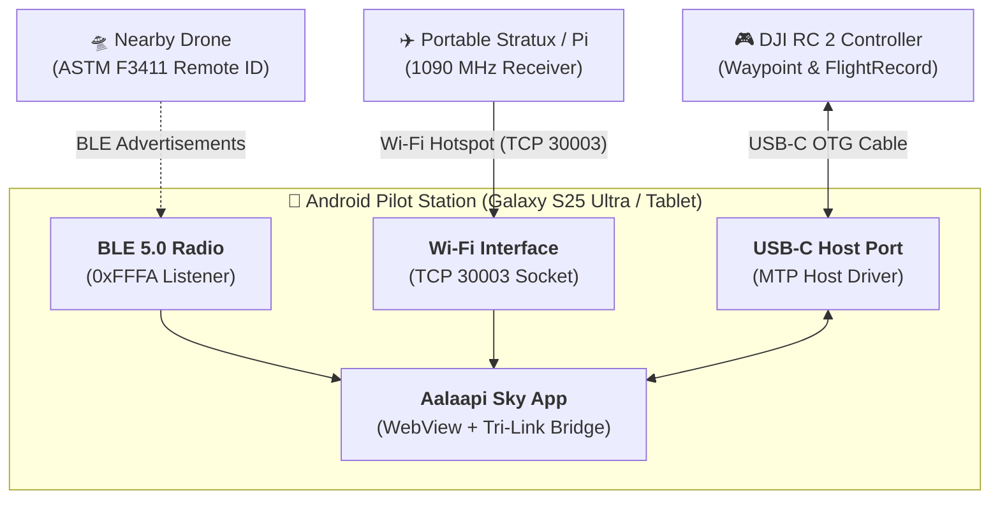

# Aalaapi Sky - Android Native Application & Field Operations Guide

This guide describes how to build, install, and operate the standalone **Aalaapi Sky Native Android Application (`android/`)** and PWA on Android smartphones and tablets (e.g., Samsung Galaxy S25 Ultra, Tab S9, Pixel 9 Pro).

---

## ⚡ Key Capabilities at a Glance

The Android app provides complete field autonomy without requiring a laptop or companion PC:

1. **Standalone 100% Offline Planning:**
   - Bundles the full single-file Aalaapi Sky application engine inside a hardware-accelerated Android `WebView`.
   - Supports 2D mission planning, 3D FPV HUD visualization, photogrammetry GSD estimation, and `.kmz` export via the Android Share sheet or direct file saving.

2. **Broadcast Remote ID Radar (Bluetooth LE 5.0 + Wi-Fi Beacon):**
   - Continuously scans for ASTM F3411 Remote ID broadcasts (BLE Service UUID `0xFFFA` / `0000fffa-0000-1000-8000-00805f9b34fb` and Wi-Fi Vendor IEs with OUI `FA:0B:BC`).
   - Uses the built-in pure-JavaScript binary decoder (`ClientRemoteIdDecoder`) to decode drone telemetry (ANSI/CTA-2063 serial numbers, GPS latitude/longitude, geodetic/barometric altitude, speed, track, and pilot/takeoff coordinates) and renders them in real time on the 2D map and 3D HUD.

3. **Multi-Source Manned Aircraft ADS-B Tracking:**
   - **Raw TCP Port 30003 SBS-1:** Connect directly to portable ADS-B receivers (`dump1090`, `readsb`, or `Stratux`) over Wi-Fi.
   - **USB OTG RTL-SDR Dongles:** Plug a standard RTL-SDR USB dongle (RTL2832U) directly into the phone via USB-C to feed local 1090 MHz frames into the app.
   - **External Cloud API:** Fetch live aircraft within your radius from `adsb.lol` or custom REST endpoints over 5G/LTE.
   - **Aalaapi Companion Bridge SSE:** Connect to `aalaapi-sky.local:8765` over Wi-Fi LAN when near a ground station.

4. **DJI RC 2 USB-C Auto-Detection & 1-Tap Sync Bar:**
   - Automatically detects when a **DJI RC 2** remote controller (`Vendor ID 0x2CA3`) is connected to the phone via USB-C OTG cable.
   - Discloses `#android-rc2-sync-bar` with the detected controller name, available waypoint mission slots, a **`⚡ Sync KMZ to RC 2`** button (protected by an overwrite confirmation dialog), and a **`📥 Pull Latest Log`** button.

---

## 🛠️ Building & Installing the Android APK

### Prerequisites
- Android Studio Ladybug / Meerkat (or newer) OR Android SDK command-line tools.
- JDK 17 or higher.

### Step 1: Compile Web Assets
Whenever you edit code in `src/`, compile the single-file web bundle:
```bash
python scratch/build.py
```
This automatically updates `android/app/src/main/assets/www/index.html`.

### Step 2: Build the APK
Open the `android/` folder in Android Studio and click **Build > Build Bundle(s) / APK(s) > Build APK(s)**, or run from terminal:
```bash
# Linux / macOS / Git Bash:
cd android && ./gradlew assembleDebug

# Windows PowerShell:
cd android; .\gradlew.bat assembleDebug
```
The compiled debug APK will be located at:
```
android/app/build/outputs/apk/debug/app-debug.apk
```

### Step 3: Install onto Device
```bash
adb install -r android/app/build/outputs/apk/debug/app-debug.apk
```

---

## 📱 Alternative: Install as a Progressive Web App (PWA)

If you prefer not to build an APK, you can run Aalaapi Sky directly in **Google Chrome on Android**:
1. Open Aalaapi Sky in Chrome (e.g. from GitHub Pages or your local Companion Bridge server).
2. Tap the Chrome three-dot menu (**⋮**) &rarr; **Add to Home screen** / **Install app**.
3. Aalaapi Sky will install as a standalone fullscreen app on your home screen and app drawer with offline caching.

---

## 🔌 Field Wiring Diagram: Tri-Link Operation



---

## 🛡️ Field Operations & 1-Tap Sync Workflow

1. **Connect Cable:** Plug a standard USB-C to USB-C cable between the phone and the bottom USB-C port of the DJI RC 2.
2. **Accept USB Permission:** Android displays a prompt: *\"Open Aalaapi Sky when this USB device is connected?\"* &rarr; Tap **OK**.
3. **Inspect the Sync Bar:** The floating `#android-rc2-sync-bar` appears at the top of the map displaying:
   `🎮 DJI RC 2 Linked | Slot: Mission Slot 1 (354A8F93...)`
4. **1-Tap Sync:**
   - Tap **`⚡ Sync KMZ to RC 2`**.
   - Review the confirmation popover detailing the target slot and mission name.
   - Tap **`✅ Confirm & Overwrite Slot`**. The mission is compiled and pushed directly to `Android/data/dji.go.v5/files/waypoint/<UUID>/<UUID>.kmz` on the controller!
5. **Post-Flight Log Pull:**
   - When the drone lands, tap **`📥 Pull Latest Log`** to copy the newest `.txt` flight record into Flight Diagnostics.
