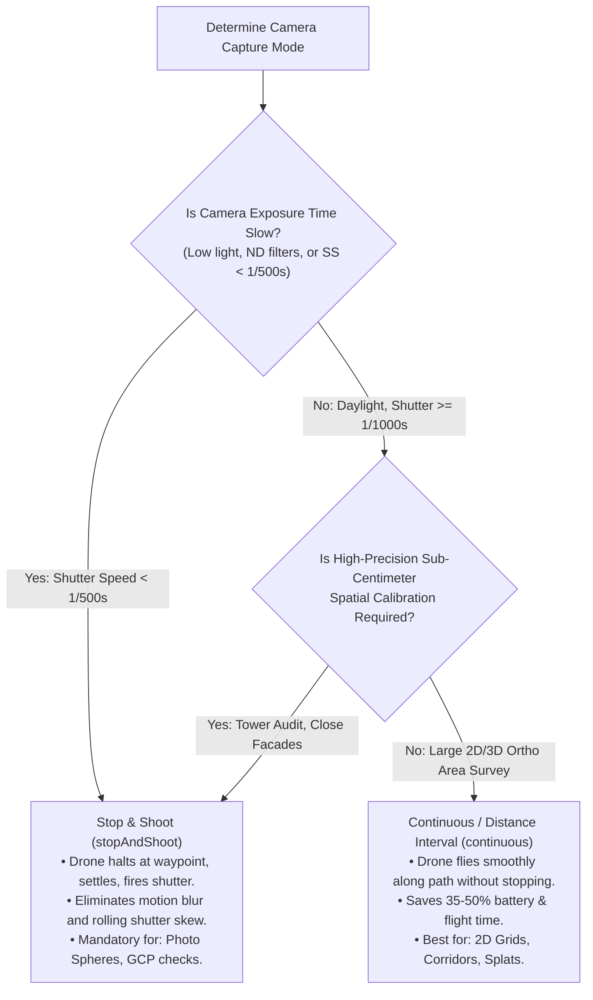
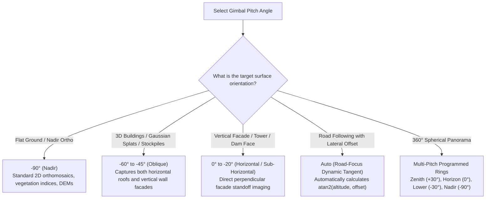
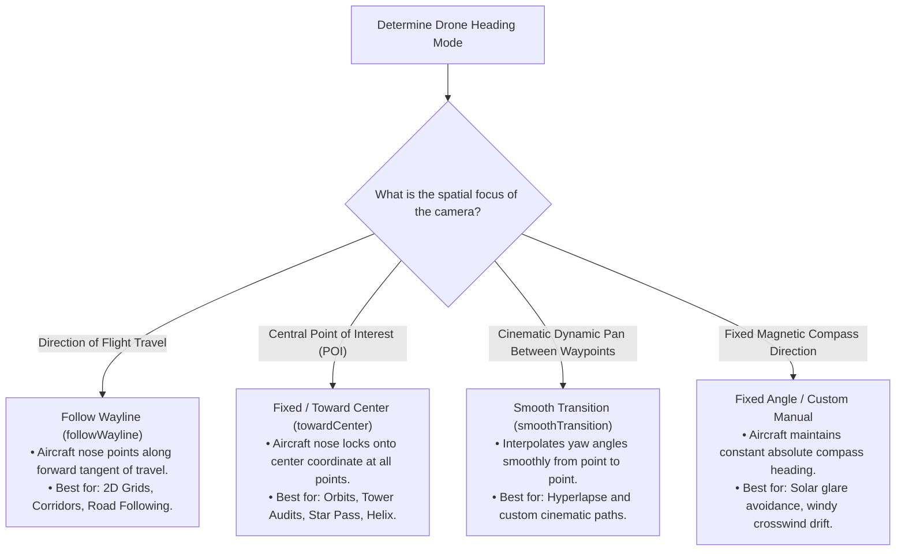
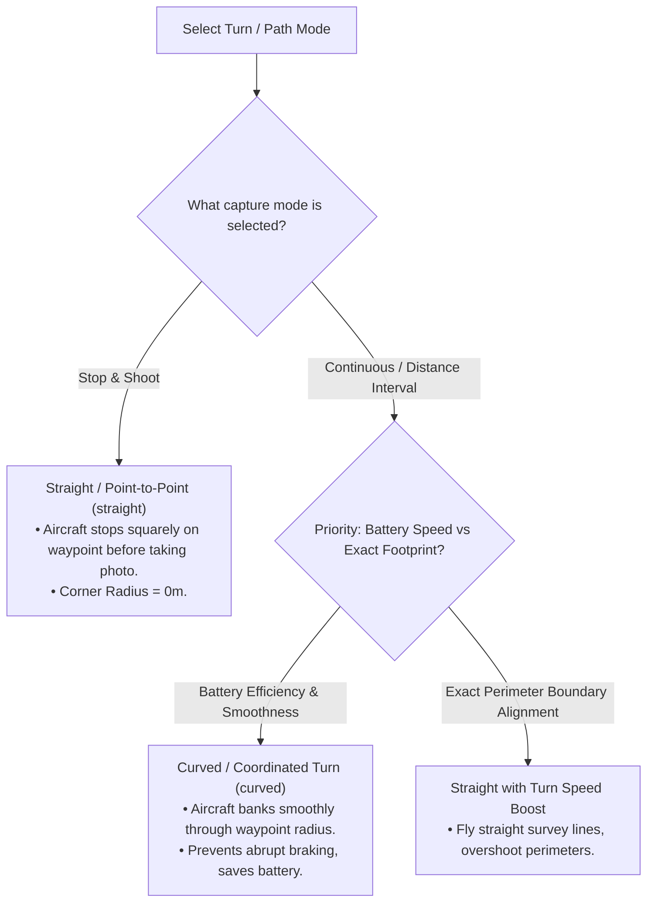
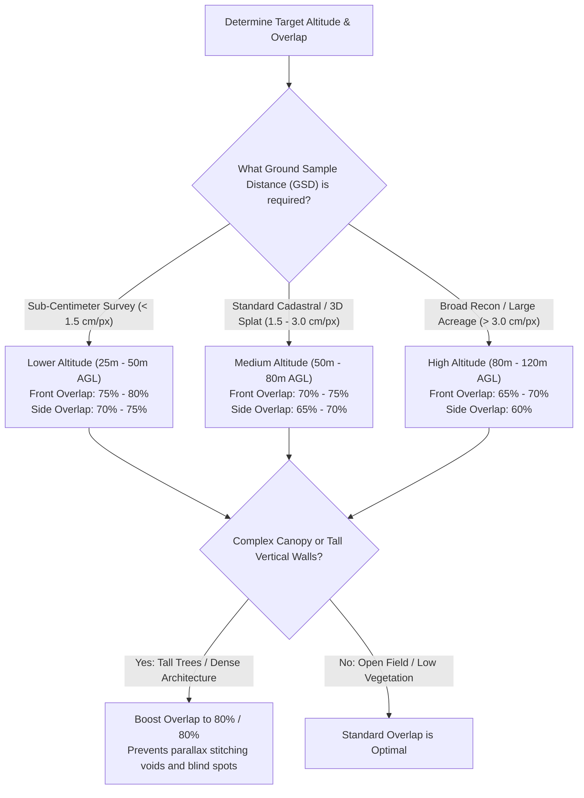

# Aalaapi Sky Flight Plan Decision Trees & Settings Guide

Welcome to the definitive reference guide for mission planning, flight pattern selection, and parameter configuration in **Aalaapi Sky**.

This document outlines the operational logic, decision trees, parameter cascades, and settings applicability across all **21 flight patterns** supported by Aalaapi Sky for DJI Fly and multi-vendor drone autopilots.

---

## Table of Contents
1. [The Three-Tier Parameter Hierarchy](#1-the-three-tier-parameter-hierarchy)
2. [Flight Pattern Selection Decision Tree](#2-flight-pattern-selection-decision-tree)
3. [Flight Settings Decision Trees](#3-flight-settings-decision-trees)
   - [Capture Mode: Stop & Shoot vs. Continuous](#capture-mode-decision-tree)
   - [Gimbal Pitch & Camera Angle](#gimbal-pitch-decision-tree)
   - [Heading Mode & Aircraft Orientation](#heading-mode-decision-tree)
   - [Path & Turn Mode (Straight vs. Curved)](#path--turn-mode-decision-tree)
   - [Overlap & Altitude (GSD & Spatial Resolution)](#overlap--altitude-gsd-decision-tree)
4. [Flight Pattern Settings Applicability Matrix](#4-flight-pattern-settings-applicability-matrix)
5. [Pattern Deep Dives & Operational Recommendations](#5-pattern-deep-dives--operational-recommendations)
6. [Best Practice Value Ranges by Mission Type](#6-best-practice-value-ranges-by-mission-type)

---

## 1. The Three-Tier Parameter Hierarchy

All flight parameters in Aalaapi Sky (including Speed, Altitude, Turn/Path Mode, Capture Mode, Heading Mode, Hover Time, Camera Actions, and Zoom) follow a strict **Three-Tier Cascading Hierarchy**:

```
┌─────────────────────────────────────────────────────────────┐
│  Tier 1: Global Mission Failsafes & Defaults                │
│  (Sidebar Section 3: #mission-failsafes-section)            │
│  • Lost Connection Action (RTH, Continue, Land, Hover)      │
│  • Mission Finish Action (RTH, Land, Hover, First Waypoint) │
│  • Global Safe RTH Altitude & Drone Model Sensor Geometry   │
└──────────────────────────────┬──────────────────────────────┘
                               │ inherits / defaults to
                               ▼
┌─────────────────────────────────────────────────────────────┐
│  Tier 2: Layer Properties & Advanced Dynamics               │
│  (Sidebar Section 2: #pattern-settings-section)             │
│  • Each layer defaults to 'inherit' (resolves to Tier 1)    │
│  • When set explicitly, overrides Tier 1 for all waypoints  │
│    belonging to this layer                                  │
└──────────────────────────────┬──────────────────────────────┘
                               │ inherits / defaults to
                               ▼
┌─────────────────────────────────────────────────────────────┐
│  Tier 3: Individual Waypoint Overrides                      │
│  (2D Map Popup #waypoint-popup & 3D FPV HUD #fpv-editor)    │
│  • Each waypoint defaults to 'inherit' (resolves to Tier 2) │
│  • When configured on a specific node, takes absolute       │
│    precedence during WPML compilation                       │
└─────────────────────────────────────────────────────────────┘
```

> [!IMPORTANT]
> Settings set to `inherit` dynamically reflect updates made to their parent tier. Always prefer configuring parameters at the **Layer (Tier 2)** level for layer-wide consistency, and reserve **Waypoint (Tier 3)** overrides for specific situational maneuvers (such as a 5-second camera zoom dwell or a localized altitude climb over an obstacle).

---

## 2. Flight Pattern Selection Decision Tree

Use this decision tree to select the optimal flight pattern based on your site characteristics, asset geometry, and survey deliverables:

```mermaid
flowchart TD
    Start["What is your primary mission objective?"] --> Area["2D Area / Topographic Survey"]
    Start --> Structure["3D Structure / Asset Inspection"]
    Start --> Linear["Linear Corridor / Infrastructure"]
    Start --> Creative["Panoramic & Creative Media"]
    Start --> Spatial["Spatial Control & Georeferencing"]

    Area --> Flat{"Terrain / Target Profile?"}
    Flat -->|"Flat / Broad Topography"| SingleGrid["2D Map (single)<br>Nadir Grid -90° Gimbal<br>Orthomosaics & DEMs"]
    Flat -->|"Complex 3D Terrain / Stockpiles"| DoubleGrid["3D Splat (double)<br>Crosshatch Grid -60° Gimbal<br>Gaussian Splatting & Photogrammetry"]
    Flat -->|"Specific Bounded Compound / Frustum"| TargetSplat["Target Splat (target-splat)<br>Auto-Trimmed Oblique Grid<br>Max Battery Savings"]
    Flat -->|"Undulating Hills / Mines / Variable Terrain"| TerrainFollow["Terrain Following (DEM-Aware Grid)<br>Constant AGL & GSD<br>Copernicus 30m / GeoTIFF DEM"]

    Structure --> Geometry{"Structure Geometry?"}
    Geometry -->|"Cylindrical / Symmetrical Monolith"| OrbitChoice{"Single vs Multi-Tier?"}
    OrbitChoice -->|"Single Elevation Ring"| Orbit["Circular Orbit (orbit)<br>Fixed Inward Yaw & Oblique Pitch"]
    OrbitChoice -->|"Multi-Altitude Layers"| MultiOrbit["Multi-Tier Orbit (multi-orbit)<br>Top-Down or Bottom-Up Rings"]
    OrbitChoice -->|"Smooth Continuous Spiral"| ContinuousHelix["Continuous Helix (continuous-helix)<br>Corkscrew Orbit, Continuous Capture"]
    
    Structure -->|"Tall Lattice / Guyed Telecom Tower"| Tower["Tower Audit (tower)<br>Vertical/Horizontal Columns + Guy Wire Buffer"]
    Structure -->|"Flat Vertical Surface (Wall / Dam / Cliff)"| VerticalFacade["Vertical Facade (vertical-facade)<br>Planar Grid, 0° Gimbal Standoff"]
    Structure -->|"High-Detail Single POI Assessment"| StarPass["Star Pass (star-pass)<br>Cross-Hatch Diametric POI Flyovers"]
    Structure -->|"Combined Ortho + Facade Mesh"| HybridChoice{"Hybrid Complexity?"}
    HybridChoice -->|"Single Ring + Grid"| GridOrbitCombo["2D+3D Hybrid (grid-orbit-combo)<br>Nadir Top Grid + Perimeter Ring"]
    HybridChoice -->|"Multi-Ring + Grid"| GridMultiOrbitCombo["Multi-Tier Hybrid (grid-multi-orbit-combo)<br>Nadir Top Grid + Multi-Tier Rings"]

    Linear --> LinearType{"Corridor Type & Width?"}
    LinearType -->|"Single Centerline with Lateral Offset"| RoadFollowing["Road Following (road-following)<br>Offset Flight Path, Road-Focus Gimbal"]
    LinearType -->|"Wide Polyline Corridor / Multi-Swath"| Corridor["Corridor Mapping (corridor)<br>Multi-Pass Swaths + Turnaround Overshoots"]

    Creative --> MediaChoice{"Media Output?"}
    MediaChoice -->|"360° x 180° Virtual Tour Panorama"| PhotoSphere["Photo Sphere (photo-sphere)<br>Pitch Rings, Stop & Shoot Locked"]
    MediaChoice -->|"Cinematic Interval Video Transit"| Hyperlapse["Hyperlapse (hyperlapse)<br>Keyframed Spline Pitch & Smooth Yaw"]
    MediaChoice -->|"Nighttime Long-Exposure Vector Art"| LightArt["Light Art (light-art)<br>Auxiliary Drone LEDs, Smooth Splines"]

    Spatial --> SpatialType{"Spatial Operation?"}
    SpatialType -->|"Custom Manual Waypoint Sequence"| Freeform["Freeform (freeform)<br>Manual Waypoint Placement"]
    SpatialType -->|"3D Keep-Out Hazard / Restricted Zone"| Exclusion["Exclusion Zone<br>Box (exclusion-box) or Polygon (exclusion-freeform)"]
    SpatialType -->|"Legal Cadastral / Survey Reference Line"| Boundary["Boundary / Parcel (boundary-polygon)<br>Perimeter & Acreage Display"]
    SpatialType -->|"Survey Control Targets / ArUco / AprilTags"| Fiducial["Fiducial / GCPs (fiducial-markers)<br>GCP Coordinate Sheets & Target Printing"]
```



---

## 3. Flight Settings Decision Trees

### Capture Mode Decision Tree


### Gimbal Pitch Decision Tree


### Heading Mode Decision Tree


### Path & Turn Mode Decision Tree


### Overlap & Altitude (GSD) Decision Tree


---

## 4. Flight Pattern Settings Applicability Matrix

This matrix details exactly which parameters apply to each of Aalaapi Sky's **21 flight patterns**:

| Flight Pattern | Altitude / Height | Width / Radius | Length / Height | Rotation Angle | Front Overlap | Side Overlap | Standoff Dist | Gimbal Pitch | Heading Mode | Path / Turn Mode | Capture Mode | Speed | Turn Speed Boost | Specific Controls |
| :--- | :---: | :---: | :---: | :---: | :---: | :---: | :---: | :---: | :---: | :---: | :---: | :---: | :---: | :--- |
| **2D Map (single)** | ✅ | ✅ | ✅ | ✅ | ✅ | ✅ | ❌ | -90° (Nadir) | Follow Wayline | Straight / Curved | Cont / Stop&Shoot | ✅ | ✅ | Turnaround Overshoot |
| **3D Splat (double)** | ✅ | ✅ | ✅ | ✅ | ✅ | ✅ | ❌ | -60° (Oblique) | Follow Wayline | Straight / Curved | Cont / Stop&Shoot | ✅ | ✅ | Turnaround Overshoot, Crosshatch passes |
| **Target Splat (target-splat)** | ✅ | ✅ | ✅ | ✅ | ✅ | ✅ | ❌ | -45° to -60° | Follow / POI | Straight / Curved | Cont / Stop&Shoot | ✅ | ✅ | Smart line trimming, Framing modes |
| **Circular Orbit (orbit)** | ✅ | Radius | ❌ | ❌ | ✅ (Spacing) | ❌ | ❌ | -45° to -30° | Fixed (Toward Center) | Curved | Cont / Stop&Shoot | ✅ | ❌ | Orbit Radius, Photo Step Angle |
| **Multi-Tier Orbit (multi-orbit)** | Min/Max Alt | Radius | ❌ | ❌ | ✅ (Spacing) | ❌ | ❌ | -60° to -30° | Fixed (Toward Center) | Curved | Cont / Stop&Shoot | ✅ | ❌ | Orbit Tiers, Min/Max Alt, Descent order |
| **Tower Audit (tower)** | Min/Max Alt | Radius | ❌ | ❌ | ✅ | ✅ | ✅ | 0° to -30° | Fixed (Toward Center) | Straight / Curved | Cont / Stop&Shoot | ✅ | ❌ | Tower Tiers, Guy Wire Buffer, Horiz/Vert passes |
| **Vertical Facade (vertical-facade)** | Min/Max Alt | Facade Width | ❌ | ✅ | ✅ | ✅ | ✅ | 0° (Horizontal) | Fixed (Facing Wall) | Straight / Curved | Cont / Stop&Shoot | ✅ | ❌ | Facade Standoff, Raster Order, Min/Max Alt |
| **Continuous Helix (continuous-helix)** | Start/End Alt | Start/End Rad | ❌ | ❌ | ✅ | ❌ | ❌ | Auto / POI | Fixed (Toward Center) | Curved (Spiral) | Continuous (Locked) | ✅ | ❌ | Helix Loops, Direction (CW/CCW), Pitch Taper |
| **Star Pass (star-pass)** | ✅ | Radius | ❌ | ✅ | ✅ (Spacing) | ❌ | ❌ | -60° to -90° | Follow Wayline | Straight | Cont / Stop&Shoot | ✅ | ❌ | Spoke / Radial count (3-12), Diametric passes |
| **360° Photo Sphere (photo-sphere)** | ✅ | ❌ | ❌ | ❌ | ❌ | ❌ | ❌ | Multi-Ring Auto | Procedural Multi-Yaw | Straight | Stop&Shoot (Locked) | ✅ | ❌ | Ring Tiers (+30°, 0°, -30°, -90°), Shots/Ring |
| **Hyperlapse (hyperlapse)** | ✅ | ❌ | ❌ | ❌ | ❌ | ❌ | ❌ | Keyframe Start/End | Smooth Transition | Curved (Spline) | Continuous (Locked) | ✅ | ❌ | Interval seconds, Keyframe interpolation |
| **Light Art (light-art)** | ✅ | Radius / Time Limit | ❌ | ❌ | ❌ | ❌ | ❌ | Ground Locked | Follow Wayline | Curved (Spline) | Continuous | 1–5 m/s | ❌ | Sky Drawing Shape, Shutter Auto-Sizing, 3D Canvas Tilt (0-90°), Compass Dial, Ground Safety Deck, Auxiliary LED beacon |
| **Grid + Orbit Combo (grid-orbit-combo)** | ✅ | Radius | ❌ | ✅ | ✅ | ✅ | ✅ (Orbit Standoff) | -45° to -60° | Follow (Grid) + Center (Orbit) | Straight / Curved | Cont / Stop&Shoot | ✅ | ✅ | Top Grid Nadir + Single Outer Orbit Ring |
| **Grid + Multi-Orbit (grid-multi-orbit-combo)** | Min/Max Alt | Radius | ❌ | ✅ | ✅ | ✅ | ✅ (Orbit Standoff) | -45° to -60° | Follow (Grid) + Center (Orbit) | Straight / Curved | Cont / Stop&Shoot | ✅ | ✅ | Top Grid Nadir + Multi-Tier Facade Orbit Rings |
| **Road Following (road-following)** | ✅ | ❌ | ❌ | ❌ | ✅ (Spacing) | ❌ | ❌ | Auto (Road Focus) | Road Focus / Follow | Straight / Curved | Cont / Stop&Shoot | ✅ | ❌ | Road Offset (Left/Right), Road Snap |
| **Corridor Mapping (corridor)** | ✅ | Corridor Width | ❌ | ❌ | ✅ | ❌ | ❌ | -90° to -60° | Follow Wayline | Straight / Curved | Cont / Stop&Shoot | ✅ | ✅ | Swath Width, Number of Passes, Overshoot |
| **Freeform Flight Plan (freeform)** | ✅ (Per WP) | ❌ | ❌ | ❌ | ❌ | ❌ | ❌ | Manual / WP Override | Manual / Follow | Straight / Curved | Cont / Stop&Shoot | ✅ | ❌ | Manual click nodes, Per-waypoint overrides |
| **Exclusion Zone: Box (exclusion-box)** | Floor / Ceiling | Box Width | Box Height | ✅ | ❌ | ❌ | ❌ | N/A | N/A | N/A | N/A | N/A | ❌ | Keep-Out Volume, Floor/Ceiling AGL limits |
| **Exclusion Zone: Freeform (exclusion-freeform)** | Floor / Ceiling | ❌ | ❌ | ❌ | ❌ | ❌ | ❌ | N/A | N/A | N/A | N/A | N/A | ❌ | Arbitrary Polygon Boundary, 3D Airspace Buffer |
| **Boundary / Parcel (boundary-polygon)** | Elevation Offset | ❌ | ❌ | ❌ | ❌ | ❌ | ❌ | N/A | N/A | N/A | N/A | N/A | ❌ | Stroke Color, Fill Opacity, Acreage/Perimeter |
| **Fiducial / GCPs (fiducial-markers)** | ❌ | ❌ | ❌ | ❌ | ❌ | ❌ | ❌ | N/A | N/A | N/A | N/A | N/A | ❌ | ArUco / AprilTag Dictionary, Physical Size, Role |

---

## 5. Pattern Deep Dives & Operational Recommendations

### 2D Map (`single`) & 3D Splat (`double`)
- **Primary Use**: Topographic mapping, multispectral agriculture, boundary elevation models (`single`); 3D mesh reconstruction, Gaussian splatting, volumetric stockpile calculations (`double`).
- **Gimbal Pitch**: `-90°` for 2D nadir orthomosaics. For 3D Gaussian Splats, set pitch to `-60°` or `-45°` so that building eaves, vertical walls, and vegetation understory are fully illuminated.
- **Turnaround Overshoot**: Set between 10m and 20m. This forces the drone to execute its 180° turnaround outside the survey area, ensuring that every photo taken within the survey zone has reached constant linear velocity and stable gimbal leveling.

### Target Splat (`target-splat`)
- **Primary Use**: High-efficiency 3D reconstruction of a specific building, compound, or site footprint.
- **Smart Line Trimming**: Automatically trims unneeded survey passes that do not project onto the target centroid, saving 30% to 50% in flight time and battery consumption compared to standard grids.
- **Framing Modes**:
  - `balanced`: Recommended default. Auto-trims distant lead-up photos where the target is merely a speck on the horizon.
  - `tight`: Maximum battery savings. Focuses only on high-density target imagery.
  - `full`: Legacy sensor frustum coverage.

### Circular Orbit (`orbit`) & Multi-Tier Orbit (`multi-orbit`)
- **Primary Use**: Monuments, isolated structures, circular tanks, architectural focal points.
- **Heading Mode**: Automatically locked to `towardCenter`. As the drone orbits along the circumference, its nose and camera continually face inward.
- **Multi-Orbit Descent Order**: Standard practice is `max-to-min` (descending rings) to prevent propeller downwash on dust and loose debris below the aircraft during early flight stages.

### Tower Audit (`tower`)
- **Primary Use**: Cellular towers, radio masts, wind turbine hubs, guyed transmission pylons.
- **Guy Wire Buffer**: Crucial failsafe setting (typically 5m to 15m) that expands the standoff clearance to keep the aircraft safely away from angled guy cables.
- **Movement Direction**: Choose `horizontal` rings for level-by-level inspection, or `vertical` columns for climbing facade audits.

### Vertical Facade (`vertical-facade`)
- **Primary Use**: High-rise building facades, dams, retaining walls, quarry cliff faces, bridge piers.
- **Gimbal Pitch**: Set to `0°` (horizontal) or `-10°` (slight downward dip).
- **Standoff Distance**: Typically 5m to 20m depending on lens focal length and target GSD. Ensure obstacle sensing system is active and calibrated.

### Continuous Helix (`continuous-helix`)
- **Primary Use**: Smooth corkscrew ascending or descending flyover around statues, towers, or spiraling architecture.
- **Path Mode**: Automatically locked to `curved` for continuous coordinated helical motion.
- **Capture Mode**: Continuous distance interval capture ensures seamless 3D point cloud generation without stopping jerk.

### Star Pass (`star-pass`)
- **Primary Use**: Forensic inspection, incident assessment, and POI cross-hatching.
- **Spokes / Radials**: Configurable between 3 and 12 diametric passes intersecting directly over the target center. Provides multi-aspect illumination from all compass azimuths.

### Corridor Mapping (`corridor`) & Road Following (`road-following`)
- **Primary Use**: Linear infrastructure: highways, pipelines, utility lines, railways, trails.
- **Corridor Mapping**: Uses multi-swath parallel passes across a polyline corridor width, with customizable turnaround overshoot beyond both ends.
- **Road Following**: Follows a single centerline with adjustable lateral offset (`-15m` to `+15m`). The camera uses `auto` road-focus mode, dynamically adjusting pitch to keep the road surface centered in frame.

---

## 6. Best Practice Value Ranges by Mission Type

| Mission Type | Recommended Pattern | Altitude (AGL) | Speed | Front Overlap | Side Overlap | Gimbal Pitch | Capture Mode | Heading Mode |
| :--- | :--- | :---: | :---: | :---: | :---: | :---: | :---: | :---: |
| **2D Topographic Ortho** | 2D Map (`single`) | 60–90m | 7–10 m/s | 75% | 70% | -90° (Nadir) | Continuous | Follow Wayline |
| **3D Gaussian Splat** | 3D Splat (`double`) | 45–65m | 5–7 m/s | 75% | 75% | -60° | Continuous | Follow Wayline |
| **Target Building Mesh** | Target Splat (`target-splat`) | 35–55m | 4–6 m/s | 80% | 75% | -45° | Continuous | Toward Center / Follow |
| **Cell Tower Audit** | Tower (`tower`) | 15–70m | 2–4 m/s | 80% | 75% | 0° to -20° | Stop & Shoot | Toward Center |
| **Dam / Wall Inspection** | Vertical Facade (`vertical-facade`) | 10–50m | 2–4 m/s | 80% | 75% | 0° | Stop & Shoot | Fixed (Toward Wall) |
| **Linear Road / Pipeline** | Corridor (`corridor`) | 50–80m | 6–8 m/s | 75% | 70% | -70° | Continuous | Follow Wayline |
| **360° Virtual Tour** | Photo Sphere (`photo-sphere`) | 30–60m | 3 m/s | N/A | N/A | Multi-Ring | Stop & Shoot | Procedural Multi-Yaw |
| **Time-Lapse Transit** | Hyperlapse (`hyperlapse`) | 20–50m | 1–3 m/s | N/A | N/A | Keyframed | Continuous | Smooth Transition |
| **Night Sky Painting** | Light Art (`light-art`) | 30–80m | 2–4 m/s | N/A | N/A | Ground Locked | Continuous | Follow Wayline |

---

*Document Version: 1.182.0 — Maintained by Aalaapi Sky Mission Systems*


---

## 4. Terrain Following & Digital Elevation Model (DEM) Engine

When surveying undulating topography, valleys, open-pit quarries, or hilly terrain, traditional flat-plane photogrammetry missions produce non-uniform Ground Sampling Distance (GSD) and risk Controlled Flight Into Terrain (CFIT). Aalaapi Sky includes an automated **Terrain Following & DEM Engine** (Issue #129):

1. **Elevation Data Sources**:
   - **Open-Meteo Global Copernicus DEM**: Global 30m/90m resolution elevation sampling requiring zero API keys.
   - **Companion Bridge Caching Proxy**: Local offline tile and elevation response cache (`/api/elevation`).
   - **Local GeoTIFF Upload**: Direct in-browser parsing of surveyor `.tif` / `.dem` DTM files for air-gapped field operations.
2. **Dynamic Waypoint Modulation**:
   - Computes target altitude $Z_i = E(x_i, y_i) + \text{Target AGL}$.
   - Applies automated two-pass slope gradient smoothing (maximum climb/descent slope angle $\le 20^\circ$) to eliminate abrupt vertical stair-stepping.
3. **Visualization & Profiling**:
   - **2D Elevation Cross-Section Profile**: Collapsible bottom drawer beneath 2D Leaflet canvas.
   - **3D Terrain Relief**: Displaces Three.js ground mesh vertices to visualize contoured ground topography and undulating flight lines.
4. **Three-Tier Cascade**:
   - Tier 1: Global Terrain Following toggle and default Target AGL in Section 3.
   - Tier 2: Layer Terrain Following override, Target AGL, Max Slope Limit ($10^\circ$ to $35^\circ$), and DEM source selector in Section 2.
   - Tier 3: Waypoint overrides displaying surface elevation with manual altitude lock.
