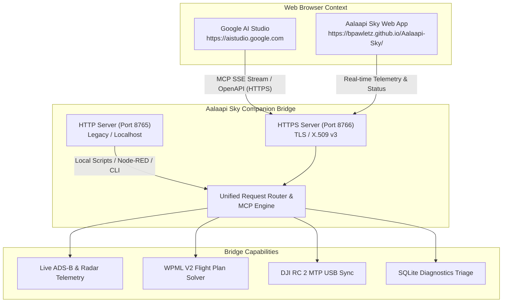

# Google AI Studio & HTTPS Integration Guide

This guide provides instructions for connecting **Google AI Studio** (`https://aistudio.google.com`) directly to the **Aalaapi Sky Companion Bridge** via native HTTPS (TLS), enabling Gemini models (Gemini 2.5 Pro, Gemini 2.0 Flash) to execute autonomous drone flight planning, query live airspace telemetry, and trigger hardware automation.

---

## 1. Why HTTPS is Required

Google AI Studio runs as a secure web application loaded over `https://aistudio.google.com`. Modern web browsers (Google Chrome, Microsoft Edge, Safari, Firefox) enforce strict security boundaries:

1. **Mixed Content Blocking:** A secure `https://` webpage is forbidden by the browser from making unencrypted `http://` network requests to localhost or local network IPs. Attempting to connect to `http://localhost:8765` results in a fatal browser mixed content block.
2. **Private Network Access (PNA):** When a public internet website makes requests to private local addresses (`localhost`, `127.0.0.1`, `192.168.x.x`), Chrome mandates that the target must be served within a secure context (HTTPS) and respond to `OPTIONS` preflight requests with `Access-Control-Allow-Private-Network: true`.

Aalaapi Sky solves this natively with a built-in, zero-dependency TLS engine that serves HTTPS on port **`8766`** alongside the existing HTTP server on port **`8765`**.

---

## 2. Architecture & Dual-Port Listening

The Companion Bridge runs both servers concurrently:



- **Port 8765 (HTTP):** Backward compatibility for local scripts (`start-bridge.bat`, `start-bridge.ps1`), CLI tools, and Node-RED pipelines.
- **Port 8766 (HTTPS):** Secure context for Google AI Studio, web-hosted Aalaapi Sky deployments (GitHub Pages), and external cloud orchestrators.

---

## 3. Starting the Bridge

Launch the companion bridge using either runner:

```bash
# Windows (PowerShell):
.\start-bridge.ps1

# Windows (Command Prompt):
start-bridge.bat

# Linux / macOS / npm:
npm run bridge
```

Upon launch, the console prints the active endpoints:

```text
[READY] Companion HTTP server active on http://127.0.0.1:8765
[READY] Companion HTTPS server active on https://127.0.0.1:8766 (Google AI Studio)
[AI STUDIO] MCP SSE Stream:  https://localhost:8766/api/mcp/sse
[AI STUDIO] OpenAPI 3.0 Spec: https://localhost:8766/api/openapi.json
```

---

## 4. Trusting the Self-Signed Certificate

When using the auto-generated self-signed certificate, your browser will display a standard local security warning until trusted:

### Option A: 1-Click Browser Acceptance (Fastest)
1. Open [`https://127.0.0.1:8766/api/status`](https://127.0.0.1:8766/api/status) in your browser (or click the **Trust SSL Cert ↗** link in the Aalaapi Sky Companion Host panel).
2. Click **Advanced** &rarr; **Proceed to 127.0.0.1 (unsafe)**.
3. You will see the JSON status response `{ "connected": ..., "https": { "enabled": true } }`.
4. Return to Google AI Studio. The browser will now allow HTTPS requests from AI Studio to the local companion bridge.

### Option B: Trusted Local CA via `mkcert` (Zero Browser Warnings)
If you prefer zero browser warnings:
```bash
# 1. Install mkcert (e.g. via choco, brew, or scoop):
choco install mkcert

# 2. Install local CA to your operating system trust store:
mkcert -install

# 3. Generate certificates for localhost:
mkdir -p scratch/certs
mkcert -cert-file scratch/certs/cert.pem -key-file scratch/certs/key.pem localhost 127.0.0.1 ::1

# 4. Restart the companion bridge:
npm run bridge
```

---

## 5. Connecting Google AI Studio

Google AI Studio provides two primary ways to interact with external tools:

### Method 1: Model Context Protocol (MCP) Stream
1. Open [Google AI Studio](https://aistudio.google.com).
2. Create a new prompt or chat session (Gemini 2.5 Pro recommended).
3. Under **Tools**, select **Model Context Protocol (MCP)**.
4. Set the Server SSE URL to:
   ```text
   https://localhost:8766/api/mcp/sse
   ```
5. Google AI Studio connects to the bridge and populates the available tools:
   - `get_airspace_telemetry`: Live ADS-B manned aircraft, NEXRAD radar, and drone status.
   - `generate_flight_plan`: Autonomous DJI WPML V2 waypoint payloads.
   - `trigger_bridge_action`: RC 2 sync, cache validation, and simulated intruders.
   - `get_latest_bad_mission`: Diagnostics failure triage.

### Method 2: OpenAPI 3.0 Function Calling
1. In Google AI Studio, expand the **Tools** drawer and select **Function Calling**.
2. Click **Import OpenAPI 3.0 Spec**.
3. Enter the OpenAPI specification endpoint URL:
   ```text
   https://localhost:8766/api/openapi.json
   ```
   *(Alternatively, open that URL in your browser, copy the JSON, and paste it into the editor).*
4. Click **Import**. Google AI Studio registers all tool functions with full parameter schemas and types.

---

## 6. Example Gemini Prompts

Once connected, you can converse with Gemini in natural language:

### Prompt 1: Airspace Deconfliction Check
> *"Are there any manned aircraft or active TFRs near my flight area at latitude 41.3215, longitude -88.9950 within 5 kilometers?"*

Gemini calls `get_airspace_telemetry` with `{ "centerLat": 41.3215, "centerLon": -88.9950, "radiusMeters": 5000 }` and provides a tactical airspace report with aircraft callsigns, altitudes, bearings, and closest points of approach (CPA).

### Prompt 2: Autonomous Flight Plan Generation
> *"Generate a circular inspection pattern at 40 meters altitude with a 35-meter radius around [41.3215, -88.9950] with 12 photo waypoints and gimbal pitch at -45 degrees."*

Gemini calls `generate_flight_plan` and returns a calculated DJI WPML V2 placemark payload ready for compilation.

### Prompt 3: 1-Click Hardware Transfer
> *"Sync the newly generated mission to my connected DJI RC 2 controller."*

Gemini calls `trigger_bridge_action` with `{ "action": "rc2_sync" }`, transferring the KMZ route directly to `/sdcard/Android/data/dji.go.v5/files/waypoint/`.

---

## 7. Legal Notice & Trademarks

- **Google AI Studio & Gemini:** *Google, Google AI Studio, Gemini, and Google Cloud* are trademarks of **Google LLC**. Aalaapi Sky is an independent third-party project and is **not affiliated with, authorized by, sponsored by, or endorsed by Google LLC**.
- **DJI:** *DJI, DJI Fly, DJI RC 2, and WPML* are trademarks of **SZ DJI Technology Co., Ltd.**
- **IRL Verification Disclaimer:** AI-generated flight plans and telemetry analyses are computational aids only and **do not constitute a guarantee, warranty, or certification of safe flight**. The Remote Pilot in Command (RPIC) maintains 100% legal and operational responsibility for airspace compliance, obstacle clearance, and safe flight execution under FAA Part 107 or applicable civil aviation regulations.
