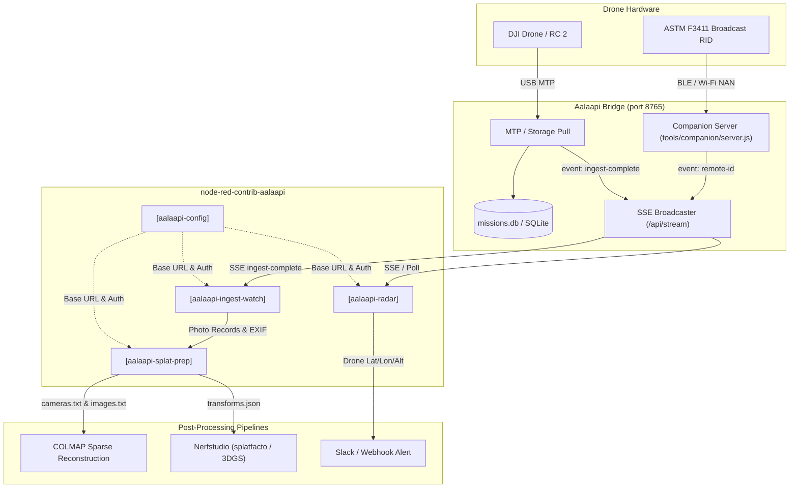

# Aalaapi Sky Node-RED Integration Guide

Welcome to the comprehensive integration and developer guide for **`node-red-contrib-aalaapi`**, the dedicated Node-RED node module designed to integrate [Aalaapi Sky Bridge](file:///tools/companion/server.js) (`127.0.0.1:8765`) directly into event-driven hardware, telemetry, and automated 3D reconstruction pipelines.

---

## Table of Contents
1. [Architecture & Overview](#1-architecture--overview)
2. [Node-RED Palette Nodes](#2-node-red-palette-nodes)
   - [aalaapi-config (Configuration Node)](#aalaapi-config)
   - [aalaapi-radar (ASTM F3411 Remote ID)](#aalaapi-radar)
   - [aalaapi-ingest-watch (Photo Ingestion Stream)](#aalaapi-ingest-watch)
   - [aalaapi-splat-prep (Transforms & Reconstruction Manifest)](#aalaapi-splat-prep)
3. [Spatial Mathematics & Coordinate Systems](#3-spatial-mathematics--coordinate-systems)
   - [Local Tangent Plane: ENU Reference Frame](#local-tangent-plane-enu-reference-frame)
   - [Gimbal vs. Airframe Attitude Hierarchy](#gimbal-vs-airframe-attitude-hierarchy)
   - [Nerfstudio Camera-to-World ($c2w$) Representation](#nerfstudio-camera-to-world-c2w-representation)
   - [COLMAP World-to-Camera ($w2c$) Representation](#colmap-world-to-camera-w2c-representation)
   - [Unit Quaternion Shepperd Formulation](#unit-quaternion-shepperd-formulation)
4. [Downstream 3D Reconstruction & Gaussian Splatting](#4-downstream-3d-reconstruction--gaussian-splatting)
   - [Nerfstudio (`splatfacto`) Training Flow](#nerfstudio-splatfacto-training-flow)
   - [COLMAP Feature Triangulation with Spatial Priors](#colmap-feature-triangulation-with-spatial-priors)
5. [Installation & Setup](#5-installation--setup)
   - [Local Directory Installation](#local-directory-installation)
   - [Development Symlink Installation](#development-symlink-installation)
   - [Importing Pre-Built Example Flows](#importing-pre-built-example-flows)
6. [Troubleshooting & Operational Best Practices](#6-troubleshooting--operational-best-practices)

---

## 1. Architecture & Overview

Aalaapi Bridge is a local daemon running on `http://127.0.0.1:8765` providing hardware interface endpoints for:
- **DJI RC 2 & USB MTP Synchronizer**: Mounts Android media storage, downloads photos, parses EXIF/XMP tags, and generates spatial checksum manifests.
- **ASTM F3411 Remote ID Radar**: Scans Bluetooth 4/5 Legacy/Extended Advertisements and Wi-Fi NAN/Beacon frames to capture broadcast Remote ID telemetry.
- **SQLite Mission Database**: Correlates flight logs with captured image frames and detected ground optical targets (AprilTag / ArUco).

`node-red-contrib-aalaapi` exposes these real-time signals as standard Node-RED nodes, enabling visual drag-and-drop workflows that trigger automated reconstruction, notifications, or cloud sync without manual command-line interaction.



---

## 2. Node-RED Palette Nodes

### `aalaapi-config`
Centralized configuration node defining the connection parameters to Aalaapi Bridge.
- **Properties**:
  - `Host`: Hostname or IP address (defaults to `127.0.0.1`).
  - `Port`: Bridge port (defaults to `8765`).
  - `Use TLS`: Connect using HTTPS instead of plain HTTP.
  - `Timeout`: HTTP request timeout in milliseconds (default `5000`).
- **Features**:
  - Includes an interactive **Test Connection** button directly inside the Node-RED configuration dialog.

---

### `aalaapi-radar`
Subscribes to ASTM F3411 Remote ID broadcast frames streamed by Aalaapi Bridge.
- **Modes**:
  - `Stream (SSE)`: Connects to `/api/stream` and responds immediately upon `event: remote-id` or periodic updates.
  - `Poll (REST)`: Periodically polls `/api/remote-id/drones` at a user-defined interval (default 3 seconds).
- **Message Payload (`msg.payload`)**:
  ```json
  {
    "count": 1,
    "totalActive": 1,
    "timestamp": "2026-10-23T07:30:00.000Z",
    "drones": [
      {
        "uasId": "1581F...",
        "latitude": 41.3215,
        "longitude": -88.9950,
        "heightAgl": 35.2,
        "altitudeMsl": 215.4,
        "heading": 182.5,
        "speed": 5.4,
        "rssi": -68
      }
    ]
  }
  ```

---

### `aalaapi-ingest-watch`
Monitors photo pulls from connected DJI controllers (e.g. DJI RC 2, RC Pro) or SD card readers.
- **Trigger**: Emits immediately when Aalaapi Bridge broadcasts `event: ingest-complete` over SSE, or upon polling completed batches.
- **Message Attributes**:
  - `msg.missionUuid`: Identifier string for the ingested flight mission.
  - `msg.targetDir`: Local directory where ingested photos are archived.
  - `msg.totalPhotos`: Count of validated photos.
  - `msg.photoPaths`: Array of absolute file paths to the ingested JPEG/DNG files.
  - `msg.manifest`: Full ingestion manifest containing SHA-256 checksums and extracted camera EXIF metadata.

---

### `aalaapi-splat-prep`
Spatial transformation and manifest formatting node. Transforms raw photo telemetry (GPS coordinates, ellipsoidal altitude, gimbal pitch/yaw, sensor optical metrics) into reconstruction-ready manifests.
- **Inputs**: Receives `msg.manifest` or array of photo spatial records from `aalaapi-ingest-watch`.
- **Outputs**:
  - `msg.transforms`: In-memory JavaScript object strictly adhering to the **Nerfstudio `transforms.json`** specification.
  - `msg.transformsPath`: Absolute path where `transforms.json` was saved (if write to disk is toggled).
  - `msg.colmapDir`: Directory containing generated COLMAP spatial priors (`cameras.txt`, `images.txt`).

---

## 3. Spatial Mathematics & Coordinate Systems

Accurate 3D reconstruction and Gaussian Splatting require strict adherence to camera reference frames. The single source of truth for all spatial calculations in `node-red-contrib-aalaapi` is located in [camera-pose.js](file:///tools/node-red-contrib-aalaapi/lib/camera-pose.js).

### Local Tangent Plane: ENU Reference Frame
GPS coordinates $(\text{latitude } \phi, \text{longitude } \lambda, \text{altitude } h)$ are converted into a metric Local Tangent Plane using an East-North-Up (ENU) coordinate frame centered at reference origin $(\phi_0, \lambda_0, h_0)$:

$$\Delta \phi = (\phi - \phi_0) \cdot \frac{\pi}{180}$$
$$\Delta \lambda = (\lambda - \lambda_0) \cdot \frac{\pi}{180}$$
$$X_{\text{East}} = \Delta \lambda \cdot R_E \cdot \cos\left(\frac{\phi + \phi_0}{2}\right)$$
$$Y_{\text{North}} = \Delta \phi \cdot R_E$$
$$Z_{\text{Up}} = h - h_0$$

where mean Earth radius $R_E \approx 6,378,137.0 \text{ m}$.

### Gimbal vs. Airframe Attitude Hierarchy
Commercial drone cameras (e.g., DJI Mini 4 Pro, Mavic 3 Enterprise, Matrice 350 RTK) operate on a stabilized 3-axis gimbal that decouples camera orientation from airframe movement:
1. **Pitch**: Extracted directly from `gimbalPitch` (typically $-90^\circ$ for nadir, $-45^\circ$ for oblique).
2. **Yaw / Heading**: Extracted from `gimbalYaw` (referenced to true North); falls back to `flightYaw` or `heading` if gimbal yaw is unavailable.
3. **Roll**: Extracted from `gimbalRoll`. Because aerial gimbals actively stabilize against horizon tilt, roll is clamped to $0^\circ$ by default unless explicit gimbal tilt telemetry is reported.

---

### Nerfstudio Camera-to-World ($c2w$) Representation

Nerfstudio uses the **OpenGL / Blender** camera convention:
- $+X$: Right
- $+Y$: Up (top of image sensor)
- $-Z$: Forward (along camera optical axis / look direction)

For an aircraft with heading/yaw $\psi$, gimbal pitch $\theta$, and gimbal roll $\phi$:
1. **Camera Look Direction** (unit forward vector $\mathbf{v}_{\text{forward}}$ in ENU):
   $$\mathbf{v}_{\text{forward}} = \begin{bmatrix} \cos(\theta) \sin(\psi) \\ \cos(\theta) \cos(\psi) \\ \sin(\theta) \end{bmatrix}$$
   *(Note: for nadir $\theta = -90^\circ$, $\mathbf{v}_{\text{forward}} = [0, 0, -1]^T$ points down toward the ground).*
2. **Camera Optical Axis in OpenGL** ($\mathbf{z}_{\text{cam}} = -\mathbf{v}_{\text{forward}}$):
   $$\mathbf{z}_{\text{cam}} = \begin{bmatrix} -\cos(\theta) \sin(\psi) \\ -\cos(\theta) \cos(\psi) \\ -\sin(\theta) \end{bmatrix}$$
3. **Camera Right Vector** ($\mathbf{x}_{\text{cam}}$):
   $$\mathbf{x}_{\text{cam}} = \begin{bmatrix} \cos(\psi) \\ -\sin(\psi) \\ 0 \end{bmatrix}$$
4. **Camera Up Vector** ($\mathbf{y}_{\text{cam}} = \mathbf{z}_{\text{cam}} \times \mathbf{x}_{\text{cam}}$):
   $$\mathbf{y}_{\text{cam}} = \begin{bmatrix} -\sin(\theta) \sin(\psi) \\ -\sin(\theta) \cos(\psi) \\ \cos(\theta) \end{bmatrix}$$

The complete $4 \times 4$ camera-to-world extrinsic matrix $M_{c2w}$ embedded in `transforms.json` is:

$$M_{c2w} = \begin{bmatrix}
\mathbf{x}_{\text{cam}} & \mathbf{y}_{\text{cam}} & \mathbf{z}_{\text{cam}} & \mathbf{C}_{\text{ENU}} \\
0 & 0 & 0 & 1
\end{bmatrix}$$

where $\mathbf{C}_{\text{ENU}} = [X_{\text{East}}, Y_{\text{North}}, Z_{\text{Up}}]^T$.

---

### COLMAP World-to-Camera ($w2c$) Representation

COLMAP uses the **OpenCV / Computer Vision** camera convention:
- $+X$: Right
- $+Y$: Down (bottom of image sensor)
- $+Z$: Forward (along camera optical axis / look direction)

1. The COLMAP world-to-camera rotation matrix $R_{w2c}$ maps points from world space into camera coordinates:
   $$R_{w2c} = \begin{bmatrix} \mathbf{x}_{\text{cam}}^T \\ -\mathbf{y}_{\text{cam}}^T \\ -\mathbf{z}_{\text{cam}}^T \end{bmatrix} = \begin{bmatrix} \mathbf{r}_{1}^T \\ \mathbf{r}_{2}^T \\ \mathbf{r}_{3}^T \end{bmatrix}$$
2. The COLMAP camera translation vector $\mathbf{t}_{w2c}$ is defined by:
   $$\mathbf{t}_{w2c} = -R_{w2c} \cdot \mathbf{C}_{\text{ENU}}$$

---

### Unit Quaternion Shepperd Formulation

To write prior poses into COLMAP `images.txt`, the rotation matrix $R_{w2c}$ must be converted to a normalized quaternion $(q_w, q_x, q_y, q_z)$. To eliminate numerical instabilities near singularities, Shepperd's algorithm selects the maximum diagonal term:

$$\text{trace}(R) = r_{00} + r_{11} + r_{22}$$

- If $\text{trace}(R) > 0$:
  $$s = 2 \sqrt{1 + \text{trace}(R)}, \quad q_w = \frac{s}{4}, \quad q_x = \frac{r_{21} - r_{12}}{s}, \quad q_y = \frac{r_{02} - r_{20}}{s}, \quad q_z = \frac{r_{10} - r_{01}}{s}$$
- Otherwise, the largest diagonal element ($r_{00}, r_{11}, \text{ or } r_{22}$) is chosen to preserve floating-point precision.

---

## 4. Downstream 3D Reconstruction & Gaussian Splatting

### Nerfstudio (`splatfacto`) Training Flow

Once `aalaapi-splat-prep` outputs `transforms.json` into the mission directory, an `exec` node in Node-RED can launch Nerfstudio training directly:

```bash
ns-train splatfacto --data /workspace/scratch/mission_archives/mission_1729074000
```

Because `transforms.json` includes calibrated camera positions and field of view (`camera_angle_x`, `fl_x`, `fl_y`), initial camera optimization converges substantially faster than training from unposed images.

### COLMAP Feature Triangulation with Spatial Priors

When dense point cloud triangulation is required prior to splatting, the generated `cameras.txt` and `images.txt` provide fixed pose constraints:

```bash
# 1. Feature extraction
colmap feature_extractor \
  --database_path database.db \
  --image_path ./images

# 2. Sequential / Spatial matcher using GPS priors
colmap spatial_matcher \
  --database_path database.db \
  --max_distance 50

# 3. Point triangulation using known poses
colmap point_triangulator \
  --database_path database.db \
  --image_path ./images \
  --input_path ./colmap_priors \
  --output_path ./sparse
```

---

## 5. Installation & Setup

### Local Directory Installation

If you are running Node-RED on the same host or development container:

```bash
# Navigate to your Node-RED user directory
cd ~/.node-red    # On Linux / macOS
cd %USERPROFILE%\.node-red    # On Windows

# Install direct from workspace
npm install /path/to/Aalaapi-Sky/tools/node-red-contrib-aalaapi
```

### Development Symlink Installation

For active development where modifications to `node-red-contrib-aalaapi` should immediately reflect upon restarting Node-RED:

```bash
cd /path/to/Aalaapi-Sky/tools/node-red-contrib-aalaapi
npm link

cd ~/.node-red
npm link node-red-contrib-aalaapi
```

### Importing Pre-Built Example Flows

A complete automated Gaussian Splatting pipeline is packaged in [auto-splat-pipeline.json](file:///tools/node-red-contrib-aalaapi/examples/auto-splat-pipeline.json):
1. In Node-RED, open the top-right hamburger menu $\equiv$.
2. Click **Import**.
3. Select **Import from File** and choose `tools/node-red-contrib-aalaapi/examples/auto-splat-pipeline.json`.
4. Deploy the flow.

---

## 6. Troubleshooting & Operational Best Practices

### Port 8765 Connection Refused
- Verify that Aalaapi Bridge is running:
  ```bash
  node tools/companion/server.js
  ```
- Use the **Test Connection** button inside `aalaapi-config` to verify HTTP connectivity and response latency.

### Missing EXIF Attitude Telemetry
- Some camera apps or manual file transfers omit DJI XMP tags (`GimbalPitchDegree`, `FlightYawDegree`).
- When XMP is absent, `camera-pose.js` safely falls back to standard EXIF GPS tags and assumes a standard nadir orientation ($-90^\circ$ pitch).
- For oblique survey flights, ensure the drone is writing DJI XMP metadata (default on DJI Pilot 2, DJI Fly, and GS Pro).

### Data Privacy & Safe Coordinate Redaction
- In compliance with the Aalaapi Sky Security Policy ([AGENTS.md Section 8](file:///AGENTS.md#L182-L191)), never share logs or workflows containing client coordinates or real-world home locations.
- For public test flows and documentation, always use synthetic rural coordinates (e.g. $[41.3215, -88.9950]$) or normalized local offsets $(0, 0)$.
