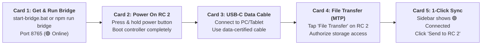

# DJI RC 2 & Aalaapi Companion Bridge Connection Guide

This guide describes how to connect the **DJI RC 2 controller** (for DJI Mini 4 Pro, DJI Air 3, and compatible aircraft) to the **Aalaapi Companion Bridge** for 1-click mission uploads, telemetry log extraction, and live flight replay.

---

## ⚡ 5-Step Visual Connection Cards



### Card 1 — Get & Launch Aalaapi Bridge
- **Step Badge**: `STEP 1 • ACQUIRE & RUN`
- **Icon**: ⚡
- **Title**: **Get & Launch Aalaapi Bridge**
- **Where to Find the Code**:
  - **Local Workspace**: Pre-bundled as [`start-bridge.bat`](file:///c:/Users/bpawl/OneDrive/code/Aalaapi-Sky/start-bridge.bat) in the root directory and [`tools/companion/server.js`](file:///c:/Users/bpawl/OneDrive/code/Aalaapi-Sky/tools/companion/server.js).
  - **Web / Hosted Users**: Clone or download from GitHub:
    ```bash
    git clone https://github.com/bpawletz/Aalaapi-Sky.git
    cd Aalaapi-Sky
    ```
- **How to Run**:
  - **Windows**: Double-click `start-bridge.bat` in the project root folder.
  - **Terminal / Mac / Linux / Termux**:
    ```bash
    npm run bridge
    ```
- **Expected Indicator**: The sidebar illuminates `🟢 Aalaapi Bridge: Online (port 8765)`.

---

### Card 2 — Power On DJI RC 2 Controller
- **Step Badge**: `STEP 2 • HARDWARE`
- **Icon**: 🎮
- **Title**: **Power On DJI RC 2**
- **Action**:
  - Press the power button once, then immediately press and hold it until the DJI boot animation completes.
  - Wait for the controller to enter the DJI Fly home screen.
- **Tip**: Verify controller battery level is above 20% and keep the screen awake during initial connection.

---

### Card 3 — Plug in USB-C Data Cable
- **Step Badge**: `STEP 3 • PHYSICAL LINK`
- **Icon**: 🔌
- **Title**: **Connect USB-C Data Cable**
- **Action**:
  - Plug a high-quality, data-capable USB-C cable from your computer or tablet into the bottom USB-C port of the DJI RC 2.
- **Caution**:
  > [!WARNING]
  > Avoid "charge-only" cables. Inexpensive cords often omit the internal USB D+/D− data lines, which prevents Windows or Android MTP drivers from enumerating the controller.

---

### Card 4 — Authorize Storage Mode on Controller
- **Step Badge**: `STEP 4 • STORAGE MODE`
- **Icon**: 📲
- **Title**: **Select "File Transfer (MTP)"**
- **Action**:
  - When connected to your PC, a USB options prompt appears on the RC 2 touchscreen. Tap **Transfer files (MTP)** or **File Transfer**.
  - *No prompt visible?* Swipe down from the top edge of the screen to reveal the Android notification shade, tap **Charging this device via USB**, and select **File Transfer**.
- **Internal Storage Path**:
  ```
  DJI RC 2/Internal Shared Storage/Android/data/dji.go.v5/files/waypoint/
  ```

---

### Card 5 — Zero-Touch 1-Click Sync
- **Step Badge**: `STEP 5 • READY TO FLY`
- **Icon**: 🚀
- **Title**: **1-Click Mission Upload**
- **Action**:
  - Once recognized, the sidebar illuminates `🟢 RC 2 USB Link: Connected`.
  - In Section 5 (Actions & Sync), click **"⚡ Send to RC 2"**.
  - Aalaapi Bridge automatically packages your active mission KMZ, generates high-contrast route preview thumbnails, and deposits both into the controller's active waypoint directory with zero command-line intervention.
- **Verification on Aircraft / Remote**:
  - In DJI Fly on the RC 2, open **Waypoint Flight** &rarr; select the synced mission &rarr; press **Go**!

---

## 📱 Platform Transfer Workflows

| Platform | Primary Transfer Method | Setup Requirements |
| :--- | :--- | :--- |
| **Windows Desktop** | Local Aalaapi Bridge (`start-bridge.bat`) | Zero-install (bundled Node daemon). Avoids Windows WPD MTP device locks. |
| **macOS / Linux** | Aalaapi Bridge (`npm run bridge`) | Node.js v18+. |
| **Android Tablet / DeX** | Direct WebUSB OTG (`#webusb-sync-btn`) | Zero-install! Connect USB-C OTG cable; tap "Allow" in Chrome. |
| **Android Smartphones (S25 Ultra / Pixel)** | Auto-Discovery & Direct MTP (`tools/companion/server.js`) | Unlock phone, select **"Transferring files" (MTP)**, and grant data access. |
| **Android Field CLI** | Termux Bridge (`tools/companion/server.js`) | Termux with `nodejs` and `android-tools`. |

---

## 📲 Connecting Android Smartphones (Samsung Galaxy, etc.) for Telemetry Pulling

When flying aircraft like the **DJI Neo 2** or **DJI Mini series** using the DJI Fly app directly on an Android smartphone:

1. **Plug in USB-C Data Cable**: Connect your phone to your PC running the Companion Bridge.
2. **Unlock the Phone Screen**: Android enforces strict security boundaries; external USB access is completely blocked while the screen is locked. Unlock via biometric (fingerprint) or PIN.
3. **Set USB Connection to "Transferring files" (MTP)**:
   - Swipe down from the top edge to open Android notifications.
   - Tap **"Charging this device via USB"** (or **USB Settings**).
   - Under *Use USB for*, select **"Transferring files"** (or **MTP**). Do not leave in "Charging only".
4. **Authorize Storage Access**:
   - If prompted with *"Allow access to phone data?"*, tap **Allow**.
5. **Instant 1-Click Telemetry Extraction**:
   - In Aalaapi Sky, the Companion Box will illuminate `🟢 [Device Name]: Connected` (e.g., `Brian's S25 Ultra`).
   - Click **"📥 Pull Flight Log"** to automatically pull the newest `FlightRecord_*.txt`, decrypt it via the DJI Cloud API, and replay the 3D trajectory in the Flight Diagnostics Center.

---

## 🛠️ Troubleshooting & Diagnostics

1. **Bridge Shows `⚪ Offline`**:
   - Ensure Node.js (v18+) is installed. Run `npm run bridge` in your terminal or check if another application is holding port 8765. Run `npm run bridge:stop` to terminate any lingering processes.
2. **Device Shows `🟡 Unplugged` or `🟠 Phone Locked / Charging Only`**:
   - Verify the USB-C cable supports data. Try another USB port.
   - Unlock your phone screen and confirm the USB notification is set to **"Transferring files" (MTP)**, not "Charging only".
3. **RC 2 Shows `🟡 Unplugged` while Cable is Connected**:
   - Verify the USB-C cable supports data. Try another USB port (direct motherboard port preferred over unpowered USB hubs).
   - Re-check that "File Transfer" mode is enabled on the RC 2 screen.
4. **Mission Not Showing in DJI Fly**:
   - Exit to the DJI Fly home screen and re-enter **Waypoint Flight** to refresh the app's internal filesystem cache.
