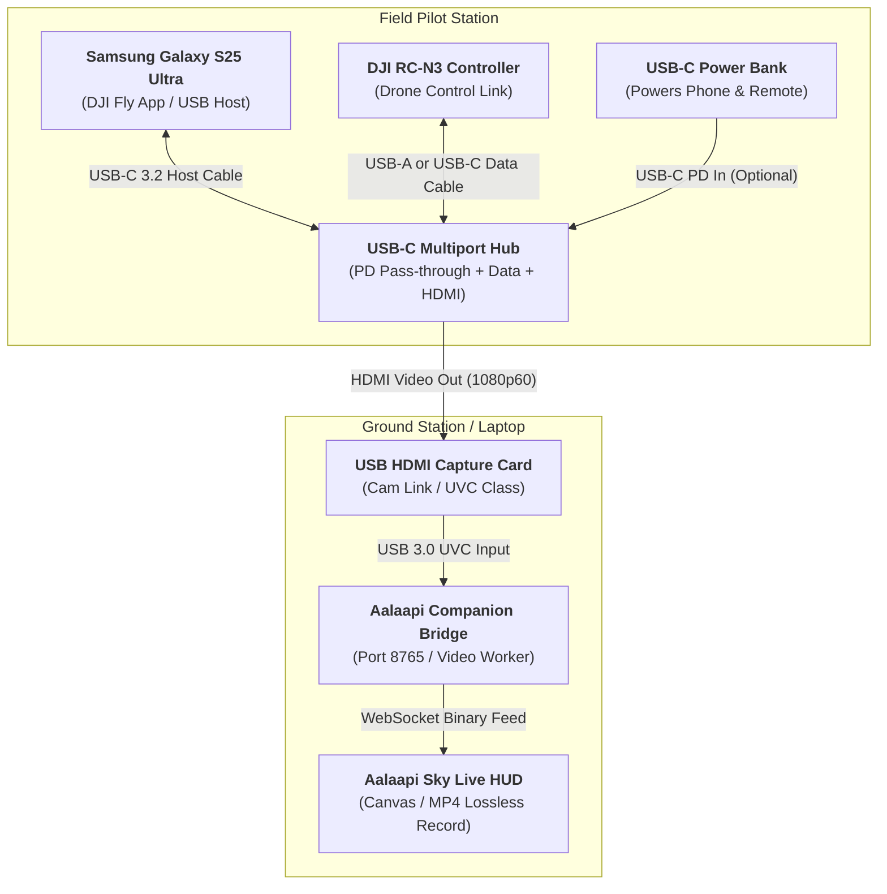

# DJI RC-N3 & Android (Samsung Galaxy S25 Ultra) Hardware Screen Streaming Guide

This guide describes how to connect the **DJI RC-N3** (as well as RC-N1 and RC-N2) clamp-style remote controller paired with a flagship Android smartphone—such as the **Samsung Galaxy S25 Ultra**—to the **Aalaapi Companion Bridge** for sub-5 millisecond ultra-low latency screen casting and local lossless MP4 recording, completely bypassing DJI Fly's built-in RTMP streaming.

---

## ⚡ Overview: Beyond RTMP

While the integrated **DJI RC 2** controller is locked to DJI's custom Android firmware (where RTMP livestreaming is the only outbound video feed), the **DJI RC-N3** uses your smartphone as the primary flight computer. 

With a modern Android flagship like the **Samsung Galaxy S25 Ultra** (Snapdragon 8 Elite, USB-C 3.2 DisplayPort Alternate Mode, Wi-Fi 7), pilots can output uncompressed 1080p60 video directly via HDMI to a USB capture card on the Companion Bridge PC with:
- **< 5 ms Latency:** Instantaneous real-time FPV HUD rendering (compared to 1,500–3,000 ms over RTMP).
- **Zero RF Interference:** Eliminates 2.4 GHz / 5.8 GHz Wi-Fi radio traffic next to the pilot's hands, safeguarding the DJI O4 drone transmission link.
- **Automatic Device Name Detection:** Aalaapi Sky automatically queries and displays the friendly hardware name of your capture device (e.g., `🔌 USB Video (HDMI Capture 0)` or `🔌 Cam Link 4K (HDMI Capture 1)`).
- **Direct PC MP4 Recording:** Record full-quality flight footage directly to your computer's high-speed drive via the `● REC` button.

---

## 🔌 Hardware Setup & Cabling Diagram

Because the DJI RC-N3 must maintain its bidirectional USB data link to DJI Fly on the phone, a standard single-port USB-C to HDMI adapter cannot be used. Instead, use a lightweight **USB-C Multiport Hub** featuring Power Delivery (PD) pass-through, a USB data port, and an HDMI output.

### Cabling Sequence
1. **Connect Hub to Phone:** Plug the main USB-C host connector of the multiport hub into the bottom USB-C port of the Galaxy S25 Ultra.
2. **Connect Controller to Hub:** Plug the DJI RC-N3 controller into a USB-A or USB-C **data** port on the hub. Verify that DJI Fly acknowledges the remote controller connection.
3. **Connect Power (Recommended):** Connect a USB-C Power Delivery (PD) power bank to the hub's PD charging input port to maintain phone and remote battery levels during long flight missions.
4. **Connect HDMI to Capture Card:** Connect a thin HDMI cable from the hub's HDMI port into a USB HDMI capture card plugged into your PC running the Aalaapi Companion Bridge.

---

## 📱 Samsung Galaxy S25 Ultra (One UI 7) Configuration

To ensure clean screen mirroring rather than Samsung's desktop mode, configure these three Android settings:

### 1. Disable Samsung DeX Auto-Start (Critical)
By default, Samsung Galaxy devices attempt to launch **Samsung DeX** (the desktop mode) when an external HDMI display is connected. When DeX launches, the HDMI output shows a desktop interface instead of DJI Fly.
- Open **Settings** &rarr; **Connected devices** &rarr; **Samsung DeX**.
- Toggle **Auto start when HDMI is connected** to **OFF**.
- *Result:* The S25 Ultra now performs pure hardware **Screen Mirroring**, projecting DJI Fly's camera feed, telemetry HUD, and map exactly as seen on your phone screen.

### 2. Display Aspect Ratio & Centering
- The Galaxy S25 Ultra screen uses a 19.5:9 aspect ratio, whereas standard HDMI capture cards accept 16:9 (1080p).
- One UI automatically pillarboxes the feed (placing clean black bars on the left and right), preserving DJI Fly's aspect ratio with zero distortion.
- In **Settings** &rarr; **Connected devices** &rarr; **Smart View / External display**, verify aspect ratio is set to **"Set to phone aspect ratio"**.

### 3. Screen Timeout & Stay Awake
- Ensure the phone display remains active during flight:
  - In **Settings** &rarr; **Display** &rarr; **Screen timeout**, select **10 minutes** or enable **"Keep screen on while viewing"**.
  - Alternatively, in **Developer Options**, toggle **"Stay awake (Screen will never sleep while charging)"**.

---

## 💻 Operating in Aalaapi Sky

1. **Launch Aalaapi Companion Bridge:**
   - Double-click [`start-bridge.bat`](file:///c:/Users/bpawl/OneDrive/code/Aalaapi-Sky/start-bridge.bat) or run `npm run bridge`.
   - The Companion status indicator in the sidebar illuminates `🟢 Aalaapi Bridge: Online`.

2. **Open the Live Video Cast HUD:**
   - In Section 4 (Live Stream & FPV View) of the sidebar, click **"🎥 Open Video Cast"** or press the FPV toggle button.

3. **Select Your Friendly USB Capture Card:**
   - In the video cast source dropdown (`#video-cast-source-select`), Aalaapi Sky dynamically enumerates your connected hardware with friendly USB names:
     - `🔌 USB Video (HDMI Capture 0)`
     - `🔌 Cam Link 4K (HDMI Capture 1)`
     - `🔌 J5-CAPTURE (HDMI Capture 1)`
   - Select your capture card. The live S25 Ultra screen appears with < 5 ms latency!

4. **Record Lossless MP4 Video:**
   - Click the **`● REC`** button in the video controls bar.
   - The recording timer counts up in real time (`00:15`, `00:30`...).
   - When finished, click **`⏹ STOP`**. The completed MP4 file is saved directly into `scratch/recordings/` on your PC.
   - Click **`📁 Clips`** to browse, download, or review saved flight videos.

---

## 🛠️ Troubleshooting & Field Tips

| Symptom | Cause | Solution |
| :--- | :--- | :--- |
| **HDMI feed shows a desktop wallpaper, not DJI Fly** | Samsung DeX auto-launched | Go to `Settings > Connected devices > Samsung DeX` and turn off "Auto start when HDMI is connected". |
| **DJI Fly says "RC not connected" when plugged into hub** | Controller is plugged into a charge-only port | Ensure the RC-N3 is plugged into a **data-capable** USB port on the hub, not a PD charging-only port. |
| **Capture card dropdown shows generic `UVC 0`** | OS permissions or driver delay | Wait 2–3 seconds for the Companion Bridge to enumerate devices, or refresh the source dropdown. Verify the capture card is recognized in Windows Device Manager. |
| **Black screen or "No Signal" on capture card** | S25 Ultra screen is turned off | Unlock the S25 Ultra and ensure DJI Fly is running in the foreground. Check HDMI cable seating. |
| **Laptop webcam opens instead of HDMI capture card** | Index 0 is the built-in webcam | In the dropdown, select the entry labeled `🔌 (HDMI Capture 1)` corresponding to your external USB capture card. |
